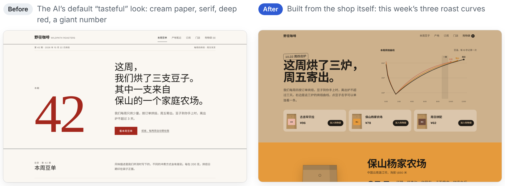
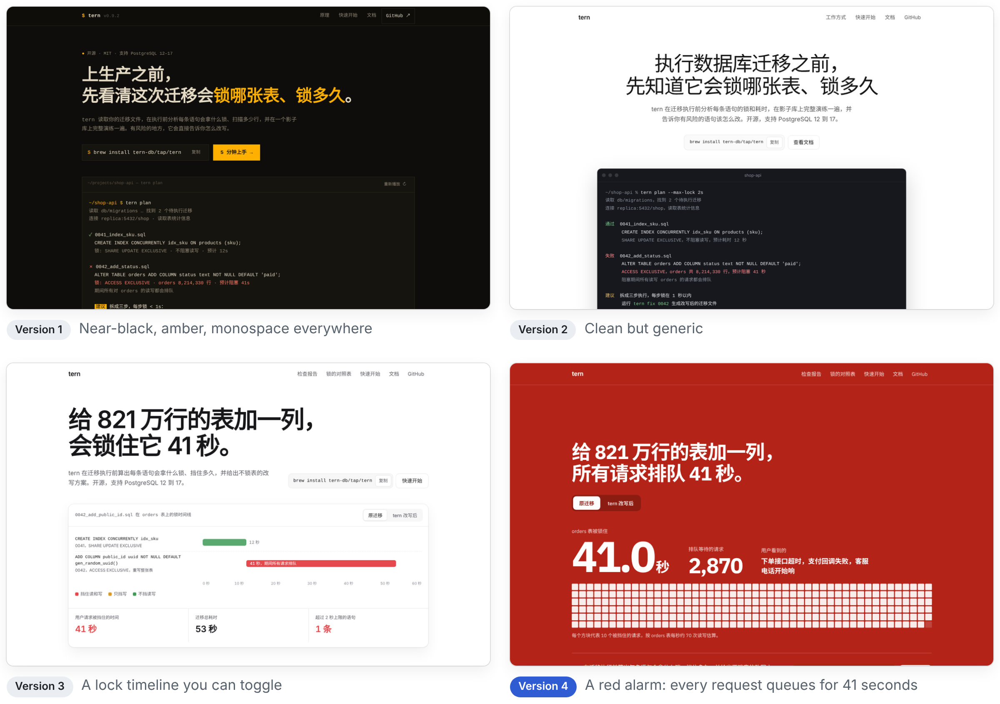
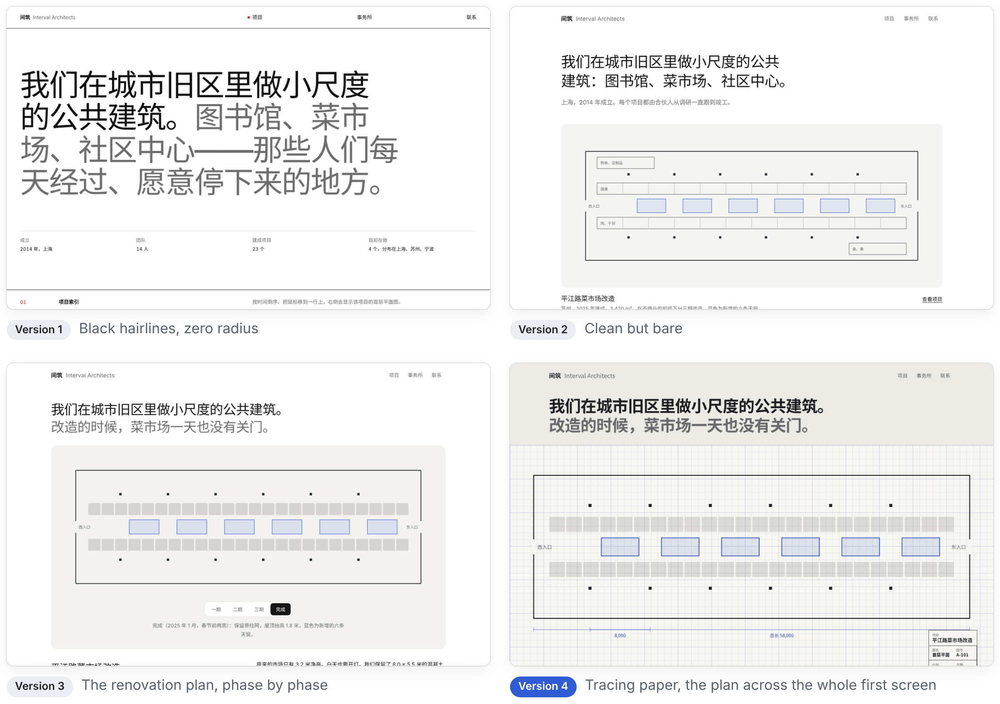
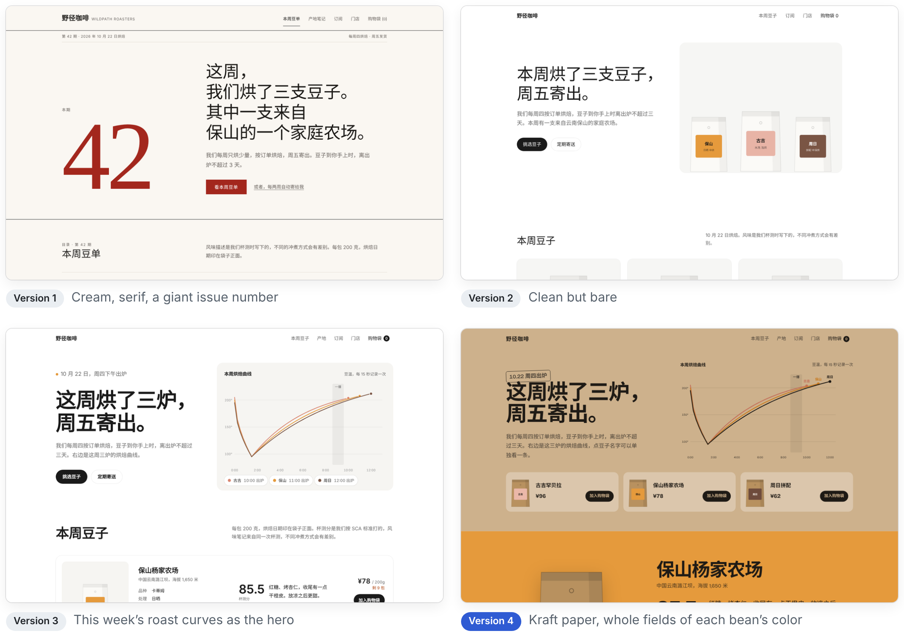
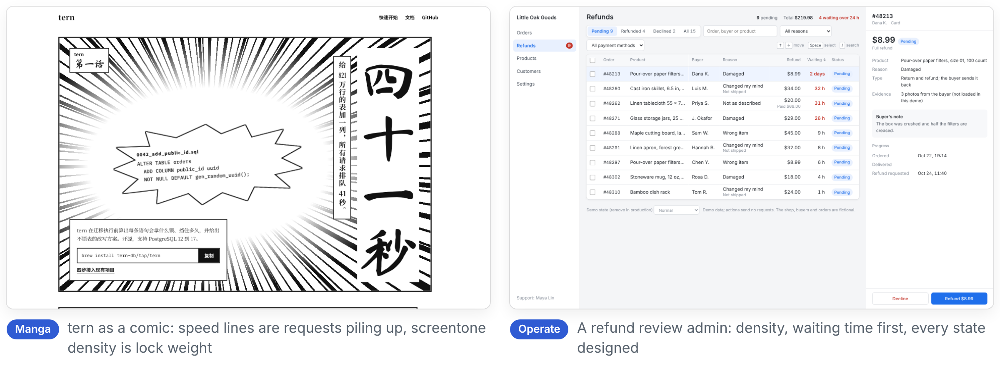

English | [简体中文](README.zh-CN.md)

# Toothpick

**A skill that helps AI spot the "AI flavor" when it builds interfaces, and design from the product itself instead.** Like a toothpick, it picks out the bits of AI flavor stuck in a design. Works with Claude, Codex and DeepSeek, in English and Chinese.

<picture>
  <source media="(prefers-color-scheme: dark)" srcset="docs/hero-en-dark.png">
  
</picture>

Same brief both times: a website for a small coffee roaster that roasts once a week. The left page came from the first version of this skill and fell straight into the AI's favorite costume. The right page came from the current version: its hero is the shop's own roast curves. (Most demo sites are in Chinese; tern also has an English version.)

## Quick start

1. Copy `skills/toothpick` to `~/.claude/skills/toothpick`
2. Ask Claude as usual: "build the home screen for a budgeting app"
3. Before writing code, Claude now shows you its reading of the project and a short design plan, and every delivery ends with a list of what is still a placeholder

Codex, DeepSeek and the Claude app are covered under [Install](#install).

## What you get back

Excerpt from the plan the AI wrote for the coffee site above, before any code:

```text
Mode: Persuade. Regulars check this week's beans once a week, mostly on phones.

Only this shop has:
- roasts every Thursday afternoon, ships Friday, roast date printed on the bag
- a roast curve for every batch, first crack around minute 9
- one label color per bean: Baoshan orange, Guji peach, Sunday brown
- third year buying from the Yang family farm in Baoshan, 40% above market price

Argument:
- Hero: this week's beans are fresh       -> the three roast curves, the roast date
- Beans: each has a clear origin and taste -> altitude, process, cupping score
- Origin: we know who grows it            -> the Yang farm story, years, price

Changed after self-check: dropped cream paper and serif (a layer-two costume),
removed the giant issue number, added substance: curves, a full field of color.

Placeholders
- Not connected: "Add to bag", "Start subscription"
- Demo content: brand, farm and numbers are fictional, labeled in the footer
```

## Why it is different

| Most design prompts and skills | Toothpick |
|---|---|
| Ship a library of styles and palettes to pick from | No style library. One test: was this made for this product, or would you do it for any product? |
| A list of banned things | 40 AI tells, each with why it reads as AI **and when it is actually fine** |
| Always restrained, or a full style costume | Restraint is the default, and it says when a strong concept is right: every device has to map to content |
| The full process even for one button | Size the change first: small changes go straight into the existing style, with no design plan |
| "Make it look like Apple / Linear" | Styles measured in a browser from Vercel, GitHub, ChatGPT, Google and Linear, and from Chinese products such as DingTalk and Juejin, used as a reference, not a template |
| Inventive features and pretty fake numbers | Reads the project first; shows only real features; mock data in one place with the real API's fields; a placeholder list on every delivery |
| Ideas from "what sites in this industry look like" | Ideas from 8–12 things that belong only to this client |

## How it works

<picture>
  <source media="(prefers-color-scheme: dark)" srcset="docs/mindmap-en-dark.png">
  
</picture>

Size the change first: one button is just changed, a new page gets a short version, and only new sites and redesigns go through all seven steps.

The seven steps, in one line each:

1. **Read the project, then decide the page's mode**: Persuade, Operate, Read or Showcase, judged per page
2. **Inventory what belongs only to this client**
3. **Write the argument**: one claim and its evidence per section; no claim, no section
4. **Write a short plan**: 4–6 colors, typefaces, layout, and the hero
5. **Ask: default or choice?** against the AI-tell list
6. **Build**, with product fragments made of real data
7. **Review at real sizes**, fix in one pass, then remove one decoration. Models that cannot see images review the code instead and say so

Removing decoration is only half the job. The other half is substance: bolder type contrast, whole fields of color, real imagery, full content. Otherwise the page reads as thin.

## The AI-tell list

| Looks like | Why it reads as AI | Fine when |
|---|---|---|
| Cream background, large serif, terracotta accent | The fixed answer to "make it tasteful" | The brand really has paper, craft or publishing roots |
| White, neutral grey, pill buttons and thin-bordered panels on every project | The next default after "don't make it look like AI" | Dashboards, tools and other Operate screens |
| Near-black, one neon accent, monospace everywhere | An AI's idea of "hacker"; GitHub, Vercel and Linear do not do this | Monospace appears only in actual code |
| An all-caps label above every heading | It usually repeats the heading | It adds real category or location information |
| 01 / 02 / 03 on things that are not steps | Numbers imply an order | The content really is a sequence |
| Features the project does not have | The page looks better and misleads the developer | Never |
| All decoration removed, nothing added back | Reads as thin; loses even to a richer page with some AI flavor | Never |

<details>
<summary>All 40 entries</summary>

**Style costumes and surface habits**: cream paper with serif and terracotta; near-black with one bright accent and monospace; newspaper hairlines with zero radius; the benchmark look as the default; style symbols posing as content; a colored stripe on the left of cards; hard offset shadows; ghost cards; stripe, grid and noise backgrounds; sketchy SVG illustrations; Unicode symbols as icons; light or dark chosen by category; the hollowed-out page

**Template parts**: an eyebrow label above every heading; middle-dot metadata; "→" after links and buttons; numbering things that are not steps; all-caps labels and small monospace data; one word in the headline recolored; huge decorative numbers

**Layer one, the old clichés**: purple-to-blue gradients and gradient text; emoji as icons; the SaaS card kit; colored icon tiles; frosted glass, blobs and grids; the "headline, three cards, stats, testimonials, pricing, FAQ" template

**Design for the sake of design**: asymmetry for its own sake; everything bold at once; over-theming

**Content**: empty copy; fabrication; inventing features the project does not have; mock data posing as real data; fake interactions; ignoring the project and starting a parallel system; perfect example data

**Motion**: every section fades and slides up; every card lifts on hover

**Software interfaces**: a dashboard built like a marketing page; designing only the perfect-data state

Full descriptions: [`skills/toothpick/references/ai-tells.md`](skills/toothpick/references/ai-tells.md)
</details>

## Three sites, four versions

The skill was shaped by building the same three sites again and again. Whatever went wrong in one version became a rule in the next.

<picture>
  <source media="(prefers-color-scheme: dark)" srcset="docs/versions-tern-en-dark.png">
  
</picture>

<picture>
  <source media="(prefers-color-scheme: dark)" srcset="docs/versions-architects-en-dark.png">
  
</picture>

<picture>
  <source media="(prefers-color-scheme: dark)" srcset="docs/versions-coffee-en-dark.png">
  
</picture>

| Version | What the skill did | What went wrong or right |
|---|---|---|
| 1 | Rules, a library of style directions, "one memorable element" | Each site fell into an AI costume |
| 2 | The AI-tell list and measured benchmarks | Clean and restrained, but bare |
| 3 | Inventory, argument first, craft details | Each hero comes from the subject, but all three sites converged on the same "benchmark" look |
| 4 | "The benchmark look as the default" added: color and material come from the subject's own world | A red alarm, tracing paper, kraft paper: each site looks like itself |

Open any page in [`demos/`](demos) (version 1), [`demos/v2/`](demos/v2), [`demos/v3/`](demos/v3) or [`demos/v4/`](demos/v4) in a browser. Brands, people and data are fictional; these sites are in Chinese.

Two more demos test cases beyond marketing pages:

<picture>
  <source media="(prefers-color-scheme: dark)" srcset="docs/demos-extra-en-dark.png">
  
</picture>

- [`demos/manga/`](demos/manga): tern as a one-chapter manga, testing a strong concept. Speed lines are requests piling up, screentone density is lock weight, and code and numbers stay horizontal
- [`demos/operate/`](demos/operate): an e-commerce refund review admin in Operate mode. Density first, with loading, error and empty states. In English and Chinese
- [`demos/v4-en/`](demos/v4-en): the English version of tern, version 4

## Install

Install one language version. Both are named `toothpick`; only the language of the instructions differs.

| Where | English | 中文 |
|---|---|---|
| Claude Code | Copy `skills/toothpick` to `~/.claude/skills/toothpick` or `.claude/skills/toothpick` in a project | `skills/toothpick-zh-CN` |
| Claude app | Zip `skills/toothpick` and upload it on the Skills page in settings | `skills/toothpick-zh-CN` |
| Codex | Put the skill folder in your project and paste the block from `prompts/codex-agents.en.md` into `AGENTS.md` | `prompts/codex-agents.zh-CN.md` |
| DeepSeek and others | Paste everything below the divider in `prompts/toothpick.en.md` into the system prompt | `prompts/toothpick.zh-CN.md` |

<details>
<summary>Files</summary>

```
.
├── README.md / README.zh-CN.md
├── skills/
│   ├── toothpick/                English skill
│   │   ├── SKILL.md              Approach, workflow, no fakes, copy, quality floor
│   │   ├── checklist.md          Questions for reviewing screenshots
│   │   └── references/
│   │       ├── ai-tells.md       The 40 AI tells
│   │       ├── benchmarks.md     Measurements from English and Chinese products
│   │       ├── big-company-details.md  Apple, Google, IBM, Microsoft guidelines, with sources
│   │       ├── craft-details.md  Radius, shadows, interaction, forms, browser-native parts
│   │       ├── readme.md         READMEs, multilingual READMEs, mind maps
│   │       ├── typography.md     Type, and notes for CJK fonts
│   │       ├── color.md          Color and dark mode
│   │       ├── web.md            Marketing pages
│   │       ├── app-desktop.md    Admin and desktop software
│   │       └── mobile.md         Mobile
│   └── toothpick-zh-CN/          Chinese skill, same structure
├── prompts/                      Condensed editions and Codex snippets
├── evals/                        Test briefs and a scoring rubric
├── docs/                         Images used in this README (src/ holds the mind map sources)
├── demos/                        Four versions of three example sites, plus the manga and admin demos
└── LICENSE                       MIT
```
</details>

## Limitations

- **Professional facts still need checking.** Version 2 of the tern page claimed that adding a NOT NULL column with a constant default locks the table for 41 seconds; that has not been true since PostgreSQL 11. AI gets technical details wrong; check them before launch.
- **Verified on Claude only.** Instructions for Codex and DeepSeek are written but have not been formally run. [`evals/`](evals) has a fixed set of test briefs and a rubric; results are welcome.
- **No automated detection.** The AI reviews its own screenshots, so the skill needs no runtime; models that cannot see images review the code instead. Nothing checks the result mechanically.
- **Interfaces and READMEs only.** Illustration, brand identity and motion pieces are out of scope.
- **The demos are mostly in Chinese.** English versions exist for tern version 4 ([`demos/v4-en/`](demos/v4-en)) and the refund admin. The coffee and architecture sites are built on Chinese details (a farm in Baoshan, tally marks written with 正) and are not translated yet.
- **No native mobile app demo yet.** The admin demo was checked at phone width, but app-only concerns such as tab bars, safe areas and gestures have no demo; `evals/` includes a brief for it.

## Contributing

Found a new AI tell? Add it to `references/ai-tells.md` in the same format: what it looks like, why it reads as AI, when it is fine. Update the English and Chinese versions in the same commit, plus one line in each condensed edition in `prompts/`. After changing the skill, run the briefs in [`evals/`](evals) before and after, and compare the scores.

## Credits

Ideas drawn from these projects, rewritten in our own words:

- Anthropic's official frontend-design skill: "default or choice", recognizing AI default styles, principles for copy
- [impeccable](https://github.com/pbakaus/impeccable): the four page modes, refinement versus redesign, the craft floor
- [taste-skill](https://github.com/Leonxlnx/taste-skill): inventorying what is unique, writing the argument first, restraint is not emptiness
- [make-interfaces-feel-better](https://github.com/jakubkrehel/make-interfaces-feel-better): radius, shadows, icons and motion
- [Vercel Web Interface Guidelines](https://github.com/vercel-labs/web-interface-guidelines): interaction, forms and content
- Design guidelines from Apple, Google Material, IBM Carbon, Microsoft Fluent and Ant Design

Looked at but not adopted: the style-library approach of [UI UX Pro Max](https://github.com/nextlevelbuilder/ui-ux-pro-max-skill).

## License

[MIT](LICENSE)
