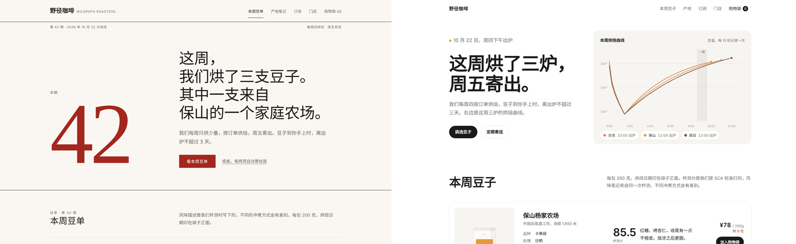
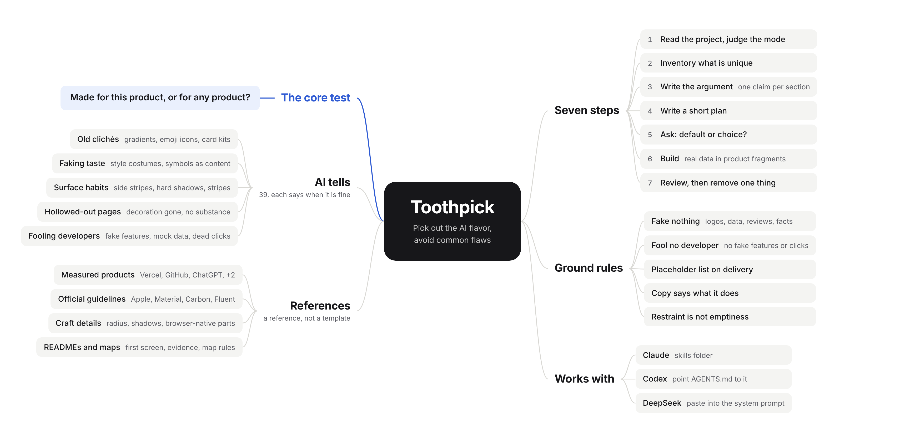
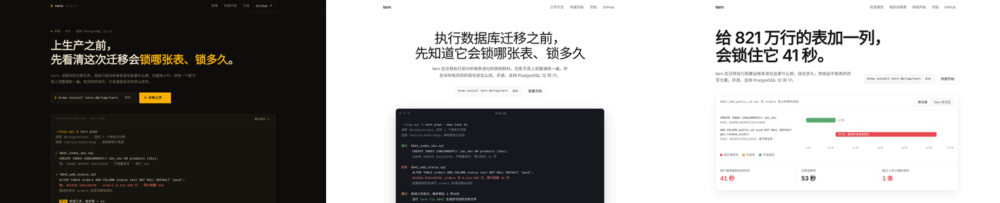
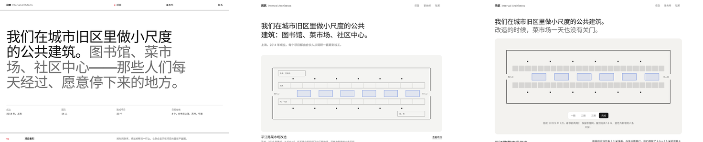

English | [简体中文](README.zh-CN.md)

# Toothpick

A skill that helps AI spot the "AI flavor" and avoid common flaws when it builds interfaces. Like a toothpick, it picks out the bits of AI flavor stuck in a design. Available in English and Chinese, and works with Claude, Codex and DeepSeek.



Same brief both times: "a website for a small coffee roaster that roasts once a week". On the left, what the first version of this skill produced: cream paper, serif type, a deep red accent and a huge issue number, the most common "tasteful" outfit an AI reaches for. On the right, the current version: the first screen shows the roast curves of the shop's three batches this week. (The demo sites are in Chinese.)

## How it differs from other design skills

**No style library.** Many design skills ship dozens of styles and hundreds of palettes for the AI to pick from. The AI then rotates through them and still dresses the page in a ready-made costume. Toothpick does not say what to use or what to avoid. It asks one question: was this choice made for this product, or would you have made it for any product?

**Every AI tell says when it is actually fine.** The list has 39 entries, each in three parts: what it looks like, why it reads as AI at a glance, and when it is the right call after all. An AI that can judge does not need to memorize rules.

**References are measured, not assumed.** We read the actual computed styles of Vercel, GitHub, ChatGPT, Google and Linear in a browser: heading weights, grey values, shadow opacity, how much of the page is product imagery. The data is a reference, not a template.

**No fake work handed to developers.** In an existing project the AI reads the project first, and the interface shows only features that really exist. When the API cannot be connected, mock data lives in one place with the same fields as the real API, and buttons that are not wired up do not pretend to work. Every delivery ends with a placeholder list: what is mock data, what is not connected, and what was assumed.

**Design ideas come from the client.** Before designing, the AI writes down 8 to 12 things that belong only to this client and to no competitor: what the name means, the street it is on, its materials, its numbers, its constraints. The roast curve above came from that list.

## Install

Install one language version only. Both are named `toothpick` and have the same content; the difference is the language the instructions are written in.

| Where | How |
|---|---|
| Claude Code | Copy `skills/toothpick` to `~/.claude/skills/toothpick` (all projects) or `.claude/skills/toothpick` in a project |
| Claude app | Zip the `skills/toothpick` folder and upload it on the Skills page in settings |
| Codex | Put the skill folder in your project, then copy the block from `prompts/codex-agents.en.md` into the `AGENTS.md` at the project root |
| DeepSeek and other models | Open `prompts/toothpick.en.md` and copy everything below the divider into the system prompt. It is a condensed version that works on its own |

For the Chinese version, use `skills/toothpick-zh-CN`, `prompts/codex-agents.zh-CN.md` and `prompts/toothpick.zh-CN.md` instead.

After installing, ask as usual, for example "build the home screen of a budgeting app". Claude picks up the skill from the description automatically.

## How it works

<picture>
  <source media="(prefers-color-scheme: dark)" srcset="docs/mindmap-en-dark.png">
  
</picture>

1. **Read the project, then decide the page's mode**: in an existing project, first find out which features, components, style variables and data fields really exist. Modes are Persuade (homepage, landing page), Operate (admin, tools), Read (docs, articles) and Showcase (portfolio), judged per page rather than per product.
2. **Inventory what belongs only to this client**, and take design ideas from that list.
3. **Write the argument first for marketing pages**: one line per section, "claim and evidence"; sections without a claim are deleted.
4. **Write a short plan**: 4 to 6 colors, typefaces, the layout idea, and what the hero of the page is.
5. **Ask whether each choice is a default or a decision**, and check against the AI-tell list.
6. **Build**: when the page shows the product's interface, build it as a real fragment of the product with real data, not grey blocks.
7. **Look at the result at real sizes**, fix everything in one pass, then remove one unnecessary decoration.

Removing decoration is only half the job. The other half is substance: bolder type contrast, whole fields of color, real imagery, sections written out in full. Otherwise the page reads as thin.

## Excerpt from the AI-tell list

| Looks like | Why it reads as AI | Fine when |
|---|---|---|
| Cream background, large serif headline, terracotta accent | The fixed answer when an AI is asked to look "tasteful" | The brand really has paper, craft or publishing roots |
| Near-black background, one neon accent, monospace everywhere | An AI's fixed idea of "hacker"; the homepages of GitHub, Vercel and Linear do not do this | Monospace appears only in actual code |
| An all-caps label above every heading | It usually just repeats the heading | It really adds category or location information |
| 01 / 02 / 03 on things that are not steps | Numbers imply an order | The content really is a sequence or timeline |
| Features in the interface that the project does not have | The page looks better and misleads the developer | Never |
| All decoration removed, nothing added back | The page reads as thin; in blind tests it loses even to a richer page with some AI flavor | Never |

The full list is in `skills/toothpick/references/ai-tells.md`.

## Three sites, three versions

This skill was shaped by building the same three sites over and over. The problems of each version went into the next version of the skill.





| Version | What the skill did then | Result |
|---|---|---|
| First | A rule set, a library of style directions, "there must be one memorable element" | Each site fell into one AI style costume: cream and serif, near-black and amber, black hairlines and zero radius |
| Second | Switched to the AI-tell list, added the measured benchmarks | Clean and restrained, but bare and thin on content |
| Third | Added "inventory what is unique", "write the argument first", and craft details | The heroes became a roast curve, a lock timeline, and a renovation plan you can step through phase by phase |

All versions are in `demos/` (first), `demos/v2/` and `demos/v3/`; open any file in a browser. Brands, people and data are fictional, and the sites are in Chinese. The screenshots were rendered without web fonts, so the real pages look slightly different.

## Files

```
.
├── README.md / README.zh-CN.md   This guide (English / Chinese)
├── skills/
│   ├── toothpick/                English skill
│   │   ├── SKILL.md              Main file: approach, workflow, no fakes, copy, quality floor
│   │   ├── checklist.md          Questions for reviewing screenshots
│   │   └── references/
│   │       ├── ai-tells.md       The AI-tell list, 39 entries
│   │       ├── benchmarks.md     Measurements from five big products
│   │       ├── big-company-details.md  Details from Apple, Google, IBM and Microsoft guidelines, with sources
│   │       ├── craft-details.md  Radius, shadows, alignment, interaction, forms, browser-native parts
│   │       ├── readme.md         Writing READMEs, multilingual READMEs, designing mind maps
│   │       ├── typography.md     Typography principles, CJK font notes
│   │       ├── color.md          Approach to color, implementing dark mode
│   │       ├── web.md            Common problems on marketing pages
│   │       ├── app-desktop.md    Common problems in admin and desktop software
│   │       └── mobile.md         Common problems on mobile
│   └── toothpick-zh-CN/          Chinese skill, same structure
├── prompts/                      Condensed edition for DeepSeek, AGENTS.md block for Codex (English and Chinese)
├── docs/                         Screenshots and mind maps used here (mindmap-*.html are the sources)
└── demos/                        Three versions of the three example sites
```

## Limitations

- **Professional facts need checking.** The second version of the tern page claimed that adding a NOT NULL column with a constant default locks the table for 41 seconds. That has not been true since PostgreSQL 11. AI gets technical details, standards and data wrong; check them before launch.
- **No automated detection.** Some open-source skills ship scripts that detect AI tells in a browser. Toothpick relies on the AI reviewing its own screenshots, which means it needs no runtime and works with DeepSeek too.
- **Interfaces and project READMEs only.** Illustration, brand identity and motion pieces are out of scope.
- **The demo sites are Chinese only.** They were built with the Chinese version of the skill and have not been translated.

## Contributing

Found a new AI tell? Add it to `references/ai-tells.md` in the same format: what it looks like, why it reads as AI, when it is fine. Change the English and Chinese versions in the same commit, and add a line to both condensed editions in `prompts/`.

## Credits

Ideas were drawn from these projects and rewritten in our own words, not copied:

- Anthropic's official frontend-design skill: "default or choice", recognizing AI default styles, principles for copy
- [impeccable](https://github.com/pbakaus/impeccable): the four page modes, refinement versus redesign, the craft floor
- [taste-skill](https://github.com/Leonxlnx/taste-skill): inventorying what is unique to the client, writing the argument first, restraint is not emptiness
- [make-interfaces-feel-better](https://github.com/jakubkrehel/make-interfaces-feel-better): details of radius, shadows, icons and motion
- [Vercel Web Interface Guidelines](https://github.com/vercel-labs/web-interface-guidelines): details of interaction, forms and content
- The official design guidelines of Apple, Google Material, IBM Carbon, Microsoft Fluent and Ant Design

Looked at but not adopted: the "style library plus palette library plus font library" approach of [UI UX Pro Max](https://github.com/nextlevelbuilder/ui-ux-pro-max-skill), for the reason given under "No style library".
