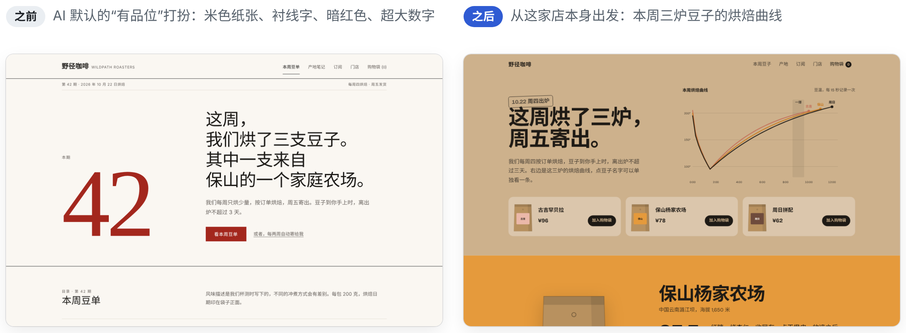
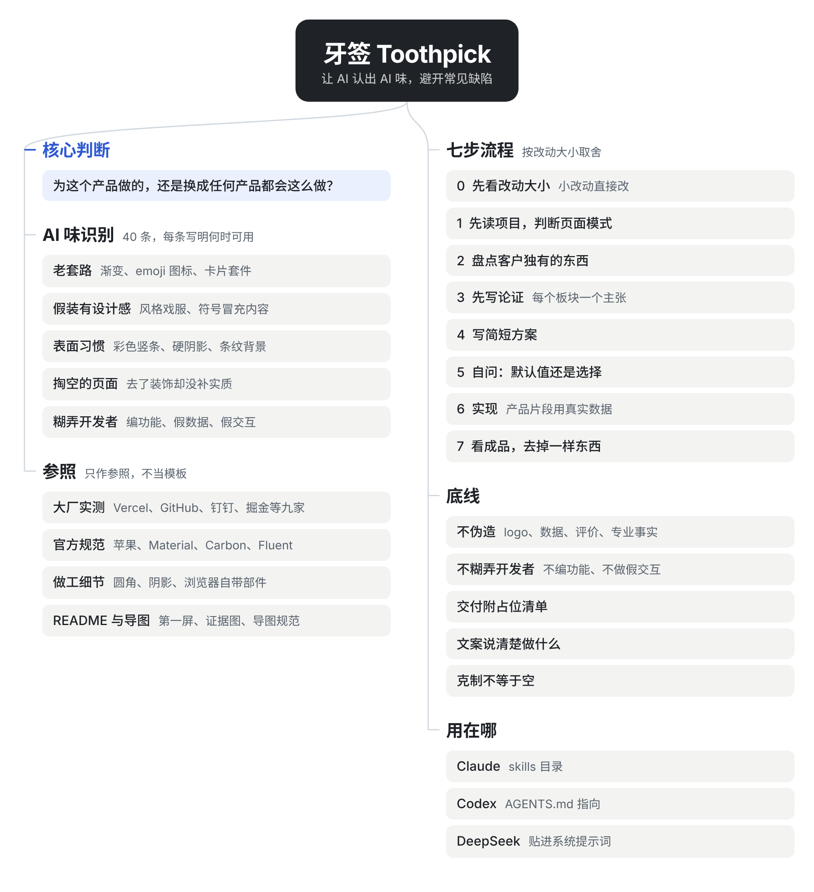
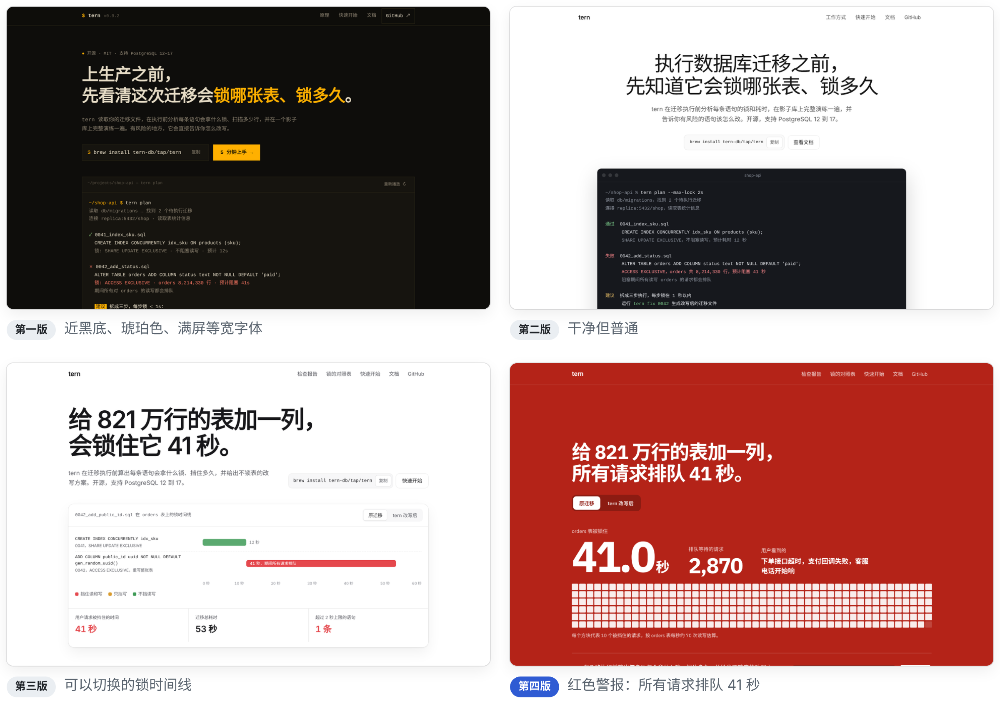
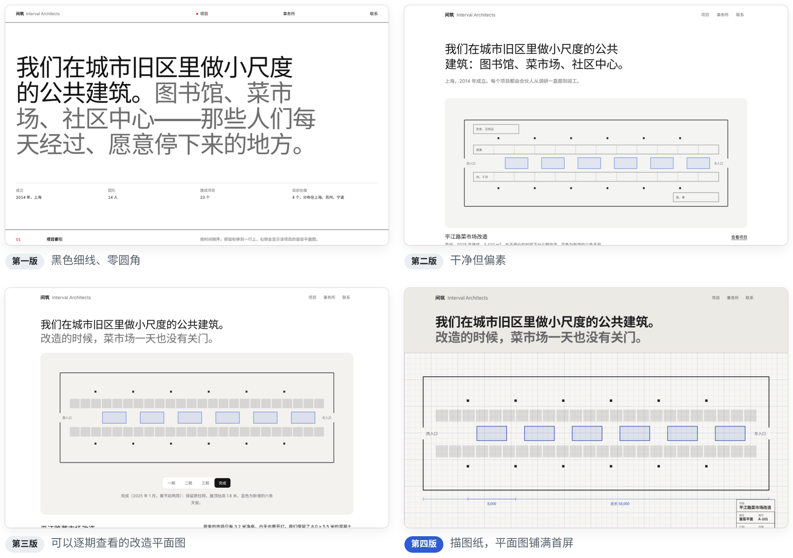
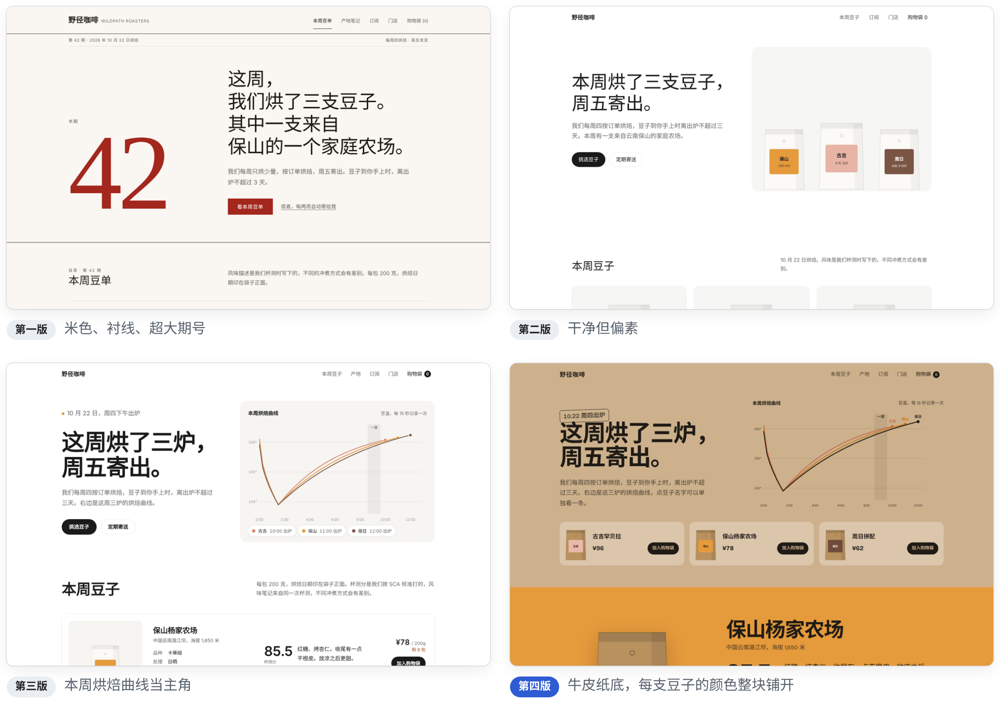
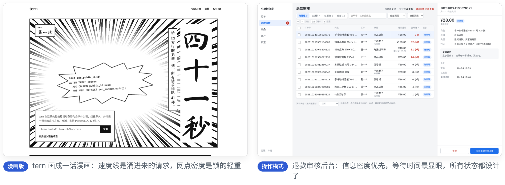

[English](README.md) | 简体中文

# 牙签 Toothpick

**一个让 AI 做界面时认出"AI 味"、从产品本身出发做设计的 skill。** 像牙签一样，把卡在设计里的 AI 味剔出来。支持 Claude、Codex、DeepSeek，提供中文和英文两个版本。

<picture>
  <source media="(prefers-color-scheme: dark)" srcset="docs/hero-zh-CN-dark.png">
  
</picture>

两边是同一个需求：给一家每周烘焙一次的小咖啡店做官网。左边出自这个 skill 的第一版，直接掉进了 AI 最爱的那套打扮；右边出自现在的版本，首屏主角是这家店自己的烘焙曲线。

## 快速开始

1. 把 `skills/toothpick-zh-CN` 复制到 `~/.claude/skills/toothpick`
2. 照常给 Claude 提需求，比如"做一个记账 App 的首页"
3. Claude 写代码前会先告诉你它读到的项目情况和一份简短的设计方案，每次交付最后都附一份"还有哪些是占位"的清单

Codex、DeepSeek 和 Claude 应用的装法见[安装](#安装)。

## 实际会得到什么

下面是 AI 给上面那个咖啡店写代码之前，写出的方案节选：

```text
模式：说服。熟客每周来看一次本周豆子，多数用手机。

只属于这家店的东西：
- 每周四下午烘豆，周五寄出，袋子上印烘焙日期
- 每一炉都有一条烘焙曲线，大约第 9 分钟一爆
- 每支豆子一个标签色：保山橙、古吉桃、周日棕
- 和保山杨家农场合作第三年，收购价比市场高四成

论证：
- 首屏：这周的豆子是新鲜的    -> 三条烘焙曲线、出炉日期
- 豆子：每支都说得清来路和味道 -> 海拔、处理法、杯测分
- 产地：我们认识种豆子的人    -> 杨家的故事、合作年数、收购价

自检后改掉的：去掉米色纸张和衬线（第二层戏服），去掉超大期号；
补上实质：烘焙曲线、整块颜色。

占位清单
- 未接通：「加入购物袋」「开始订阅」
- 示例内容：品牌、农场和数字都是虚构的，页脚已注明
```

## 和别的做法有什么不同

| 常见的设计提示词和 skill | 牙签 |
|---|---|
| 准备一个风格库、配色库让 AI 挑 | 不给风格库。只问一个问题：这是为这个产品做的，还是换成任何产品都会这么做？ |
| 列一堆禁止项 | 40 条 AI 味，每条写明为什么像 AI，**以及什么时候其实可以用** |
| 要么一律克制，要么套一身风格 | 克制是默认；写明了什么时候该做强概念：每个手法都要对应一条内容 |
| 改一个按钮也走全套流程 | 先看改动大小：小改动直接按现有风格改，不写设计方案 |
| "做得像苹果 / Linear 一样" | 在浏览器里实测了 Vercel、GitHub、ChatGPT、Google、Linear，以及钉钉、掘金等中文产品的样式，只作参照，不当模板 |
| 编功能、写死好看的假数字 | 先读项目，只展示真有的功能；模拟数据集中放、字段和真实接口一致；每次交付附占位清单 |
| 想法来自"这个行业的网站一般长什么样" | 想法来自 8 到 12 个只属于这个客户的东西 |

## 它是怎么工作的

<picture>
  <source media="(prefers-color-scheme: dark)" srcset="docs/mindmap-zh-CN-dark.png">
  
</picture>

先看改动有多大：改一个按钮直接改，新页面走简化流程，新网站和改版才走完整的七步。

七步流程，一步一句：

1. **先读项目，再判断页面模式**：说服、操作、阅读、展示，按页面判断
2. **盘点只属于这个客户的东西**
3. **先写论证**：每个板块一个主张加证据，没有主张就没有这个板块
4. **写简短方案**：4 到 6 个颜色、字体、布局、主角
5. **自问：默认值还是选择？** 对照识别清单检查
6. **实现**：产品片段用真实数据来做
7. **在实际尺寸下看成品**，一次改完，最后去掉一件装饰。不能看图的模型改为对照代码自检，并说明没有看过

去掉装饰只是一半。另一半是补上实质内容：更大胆的字号对比、整块的颜色、真实的画面、写满内容的板块。否则页面会显得单薄。

## AI 味识别清单

| 表现 | 为什么像 AI | 什么时候可以用 |
|---|---|---|
| 米色背景、衬线大标题、陶土色强调 | AI 被要求"有品位"时的固定答案 | 品牌确实有纸质、手工、出版物背景 |
| 什么项目都是白底、中性灰、胶囊按钮、细框面板 | "别做成 AI 味"之后的下一个默认值 | 后台、工具这类操作型界面 |
| 近黑背景、一个荧光色、满屏等宽字体 | AI 对"极客"的固定想象，GitHub、Vercel、Linear 都不这样做 | 等宽字体只出现在真正的代码里 |
| 每个标题上面一行全大写小标签 | 通常只是把标题再说一遍 | 它确实提供了分类或位置信息 |
| 不是步骤也编号 01 / 02 / 03 | 编号暗示先后顺序 | 内容真的是步骤 |
| 界面上出现项目里没有的功能 | 页面好看了，却误导了开发者 | 不适用 |
| 去掉了所有装饰，却什么都没补上 | 页面单薄，甚至不如有点 AI 味但内容丰富的页面 | 不适用 |

<details>
<summary>全部 40 条</summary>

**风格戏服与表面习惯**：米色纸张加衬线加陶土色；近黑底加单一亮色加等宽字体；报纸式细线加零圆角；大厂参照当成默认值；风格符号冒充内容；卡片左侧彩色竖条；硬偏移阴影；幽灵卡片；条纹、网格、噪点背景；手绘感 SVG 插画；用 Unicode 符号当图标；按品类选明暗；掏空的页面

**模板小零件**：每个标题上面一行小标签；中点分隔的元信息；链接和按钮后面加"→"；不是步骤也编号；全大写小标签和小字号等宽数据；标题里只给一个词换颜色；超大装饰数字

**第一层老套路**：紫蓝渐变和渐变文字；emoji 当图标；SaaS 卡片套件；彩色图标底块；毛玻璃、光斑、网格背景；"居中标题、三列卡片、数据条、评价、价格、FAQ"模板

**为了设计而设计**：不对称为了不对称；什么都很大胆；主题化过度

**内容**：空洞文案；伪造；编造项目没有的功能；假数据冒充真数据；假交互；不看项目就另起一套；完美示例数据

**动效**：每个区块都淡入上浮；每张卡片悬停都浮起放大

**软件界面**：把后台做成营销页；只做数据完美的状态

完整说明见 [`skills/toothpick-zh-CN/references/ai-tells.md`](skills/toothpick-zh-CN/references/ai-tells.md)
</details>

## 三个网站，四个版本

这个 skill 是靠反复做同样三个网站改出来的。每一版出的问题，都变成了下一版的规则。

<picture>
  <source media="(prefers-color-scheme: dark)" srcset="docs/versions-tern-zh-CN-dark.png">
  
</picture>

<picture>
  <source media="(prefers-color-scheme: dark)" srcset="docs/versions-architects-zh-CN-dark.png">
  
</picture>

<picture>
  <source media="(prefers-color-scheme: dark)" srcset="docs/versions-coffee-zh-CN-dark.png">
  
</picture>

| 版本 | 当时 skill 的做法 | 结果 |
|---|---|---|
| 第一版 | 一套规则、一个风格方向库、"必须有一处记忆点" | 三个网站各中一种 AI 戏服 |
| 第二版 | 改成识别清单，加入大厂实测参照 | 干净克制，但偏素 |
| 第三版 | 加入盘点、先写论证、做工细节 | 每个首屏的主角都来自对象本身，但三个网站长成了同一个"大厂样子" |
| 第四版 | 加入"大厂参照当成默认值"：颜色和材料从对象自己的世界里来 | 红色警报、描图纸、牛皮纸，三个网站各有各的样子 |

四个版本的页面在 [`demos/`](demos)（第一版）、[`demos/v2/`](demos/v2)、[`demos/v3/`](demos/v3)、[`demos/v4/`](demos/v4)，用浏览器打开即可。品牌、人物和数据都是虚构的。

另外两个示例，检验营销页以外的情况：

<picture>
  <source media="(prefers-color-scheme: dark)" srcset="docs/demos-extra-zh-CN-dark.png">
  
</picture>

- [`demos/manga/`](demos/manga)：tern 画成一话漫画。用来检验强概念：速度线是涌进来的请求，网点密度是锁的轻重，代码和数字保持横排
- [`demos/operate/`](demos/operate)：电商退款审核后台，操作模式。信息密度优先，加载中、出错、无数据状态都做了，有中文版和英文版
- [`demos/v4-en/`](demos/v4-en)：tern 第四版的英文版

## 安装

中文版和英文版只装一个。两个版本的 `name` 都是 `toothpick`，区别只是写给 AI 的说明用什么语言。

| 用在哪里 | 中文版 | English |
|---|---|---|
| Claude Code | 把 `skills/toothpick-zh-CN` 复制到 `~/.claude/skills/toothpick`，或项目里的 `.claude/skills/toothpick` | `skills/toothpick` |
| Claude 应用 | 把 `skills/toothpick-zh-CN` 打包成 zip，在设置的技能页面上传 | `skills/toothpick` |
| Codex | 把 skill 文件夹放进项目，再把 `prompts/codex-agents.zh-CN.md` 里的那段复制到 `AGENTS.md` | `prompts/codex-agents.en.md` |
| DeepSeek 和其他模型 | 把 `prompts/toothpick.zh-CN.md` 分隔线以下的内容贴进系统提示词 | `prompts/toothpick.en.md` |

<details>
<summary>文件结构</summary>

```
.
├── README.md / README.zh-CN.md
├── skills/
│   ├── toothpick/                英文版 skill
│   └── toothpick-zh-CN/          中文版 skill
│       ├── SKILL.md              思路、流程、不伪造不糊弄、文案、质量底线
│       ├── checklist.md          截图自评清单
│       └── references/
│           ├── ai-tells.md       40 条 AI 味
│           ├── benchmarks.md     英文和中文产品的实测数据
│           ├── big-company-details.md  苹果、谷歌、IBM、微软规范细节，带出处
│           ├── craft-details.md  圆角、阴影、交互、表单、浏览器自带部件
│           ├── readme.md         README、多语言 README、思维导图
│           ├── typography.md     排版和中文字体
│           ├── color.md          配色和深色模式
│           ├── web.md            营销页
│           ├── app-desktop.md    后台和桌面软件
│           └── mobile.md         移动端
├── prompts/                      精简版和 Codex 片段
├── evals/                        测试用例和评分表
├── docs/                         本说明用到的图片（src/ 里是思维导图源文件）
├── demos/                        三个示例网站的四个版本，以及漫画版和后台示例
└── LICENSE                       MIT
```
</details>

## 局限

- **专业事实仍要核对。** 第二版 tern 页面写了"加一个带常量默认值的非空列会锁表 41 秒"，这在 PostgreSQL 11 以后并不成立。AI 写技术细节会出错，上线前要人工核对。
- **只在 Claude 上验证过。** Codex 和 DeepSeek 的用法写好了，但还没有正式跑过。[`evals/`](evals) 里有一组固定的测试需求和评分表，欢迎用它们跑一遍再提交结果。
- **没有自动检测。** 由 AI 自己截图自评，所以不依赖任何运行环境；不能看图的模型改为对照代码自检。没有程序去机械检查结果。
- **只覆盖界面和 README。** 插画、品牌标识、动画短片不在范围内。
- **示例大多是中文。** 英文版只有 tern 第四版（[`demos/v4-en/`](demos/v4-en)）和退款审核后台。咖啡店和建筑事务所建立在保山的农场、正字计数这些中文细节上，暂时没有翻译。
- **还没做过原生手机 App。** 后台示例检查了手机宽度，但标签栏、安全区、手势这些 App 才有的问题还没有示例；`evals/` 里有一条对应的测试需求。

## 参与改进

发现新的 AI 味，按"表现、为什么像 AI、什么时候可以用"的格式补进 `references/ai-tells.md`。中英文两个版本在同一次提交里一起改，再在 `prompts/` 的两份精简版里各加一句。改了 skill 之后，用 [`evals/`](evals) 里的需求前后各跑一次，对比分数。

## 参考来源

思路参考了以下项目，用自己的话重写：

- Anthropic 官方 frontend-design skill：判断"默认值还是选择"、AI 默认风格的识别、文案原则
- [impeccable](https://github.com/pbakaus/impeccable)：四种页面模式、改版和优化的区别、做工底线
- [taste-skill](https://github.com/Leonxlnx/taste-skill)：盘点客户独有的东西、先写论证、克制不等于空
- [make-interfaces-feel-better](https://github.com/jakubkrehel/make-interfaces-feel-better)：圆角、阴影、图标、动效的细节
- [Vercel Web Interface Guidelines](https://github.com/vercel-labs/web-interface-guidelines)：交互、表单、内容的细节
- 苹果、谷歌 Material、IBM Carbon、微软 Fluent、Ant Design 的官方设计规范

看过但没有采用：[UI UX Pro Max](https://github.com/nextlevelbuilder/ui-ux-pro-max-skill) 的风格库做法。

## 许可证

[MIT](LICENSE)
